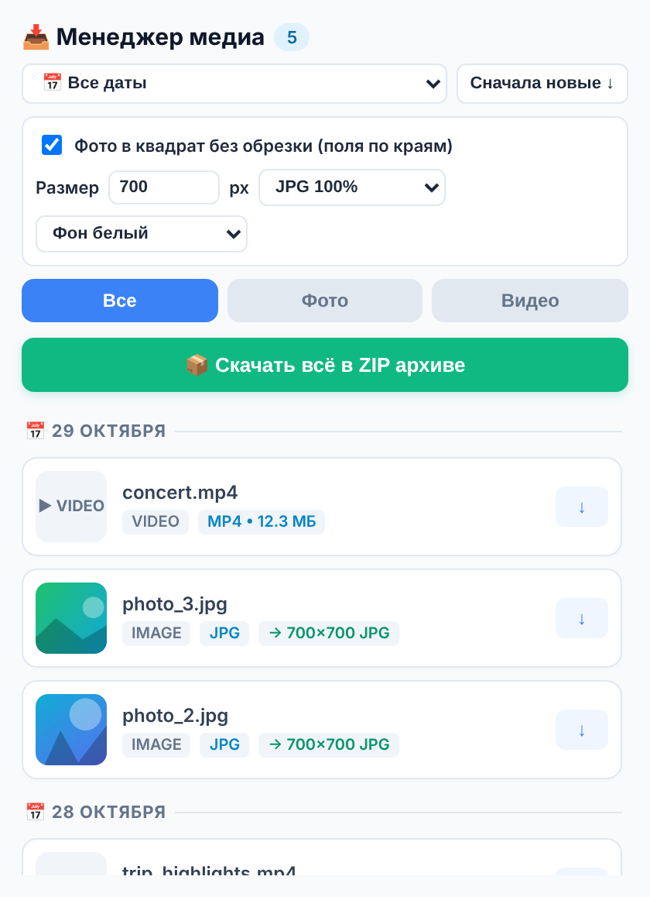
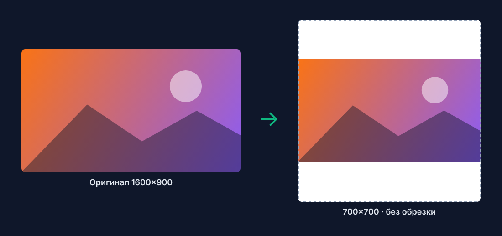

<div align="center">


# Universal Media Downloader

**Расширение для Chrome / Edge: скачивает фото и видео из Telegram Web (включая закрытые каналы) и с любых сайтов, раскладывает по датам, упаковывает в ZIP и приводит фото к квадрату 700×700 без обрезки и без потери качества.**


</div>

---

<table>
<tr>
<td width="50%" valign="top">

### ✨ Возможности

- 📥 **Фото и видео** со страницы — одним кликом или всё сразу
- 🎬 **Видео из Telegram Web целиком**, даже потоковые (`stream/`) — докачивает по частям
- 🔒 **Закрытые каналы и группы** — работает в приватных каналах и чатах, где вы состоите: медиа берётся прямо из открытой вкладки Telegram Web
- 📅 **Группировка по датам** из ленты Telegram + фильтр по дате
- 📦 **ZIP-архив** с папками по датам — без сторонних библиотек
- 🖼 **Квадрат 700×700** без обрезки — фото вписывается целиком, по краям поля
- 💎 **Без потери качества** — обработка всегда от оригинала, ступенчатое уменьшение, JPG 100% или PNG без потерь
- ⚡ **Кнопка «Скачать» прямо на странице** при открытии фото или видео
- 🧹 Пропускает стикеры, эмодзи, аватарки и реакции

</td>
<td width="50%" valign="top">



</td>
</tr>
</table>

## 🖼 Как работает 700×700



Фото любых пропорций вписывается в квадрат **целиком** — ничего не отрезается, свободное место заливается фоном (белый / чёрный / прозрачный для PNG).

Чтобы картинка оставалась чёткой:

1. Берётся **оригинал** в полном разрешении (из кэша страницы, по сети или с `` без сжатия).
2. Большие фото уменьшаются **ступенями по 2×** со сглаживанием `high` — без «лесенки» и мыла.
3. Картинка ставится на целые пиксели — края не размываются.
4. Сохранение в **JPG 100%** или **PNG без потерь**. Если фото уже 700×700 в нужном формате — сохраняется оригинал без перекодирования.
5. Учитывается EXIF-ориентация — фото с телефона не переворачиваются.

## ⚙️ Настройки

Настройки в окне расширения сохраняются и действуют и для списка, и для кнопки на странице.

| Параметр | Значения | По умолчанию |
|---|---|---|
| Фото в квадрат без обрезки | вкл / выкл | вкл |
| Размер | 16 – 5000 px | **700** |
| Формат | JPG 100% · PNG без потерь | JPG |
| Фон полей | белый · чёрный · прозрачный (только PNG) | белый |

> Если выключить квадрат — фото сохраняются как есть, в исходном формате.

## 🚀 Установка

1. Скачайте `universal-media-downloader-v1.5.zip` из раздела [**Releases**](../../releases/latest) и распакуйте.  
   *(или `git clone` этого репозитория)*
2. Откройте `chrome://extensions` (в Edge — `edge://extensions`).
3. Включите **«Режим разработчика»** в правом верхнем углу.
4. Нажмите **«Загрузить распакованное расширение»** и выберите папку с `manifest.json`.
5. Закрепите иконку на панели и обновите открытые вкладки.

## 📖 Использование

**Всё со страницы сразу**
1. Откройте чат в Telegram Web или любую страницу с медиа и пролистайте до нужных сообщений.
2. Нажмите иконку расширения — появится список найденных фото и видео, сгруппированных по датам.
3. Отфильтруйте по типу или дате → **«📦 Скачать всё в ZIP архиве»** или **↓** у отдельного файла.

**Закрытые каналы**
Вступите в канал или группу по приглашению, откройте его в Telegram Web — и пользуйтесь расширением как обычно. Ссылки-приглашения, боты и сторонние сервисы не нужны: всё, что вы видите в ленте, доступно для скачивания.

**Одно фото / видео**
Откройте медиа на странице — в правом нижнем углу появится плашка **«⬇ Скачать»**.

## 🗂 Структура

```
├── manifest.json   — конфигурация расширения (MV3)
├── popup.html      — интерфейс окна
├── popup.js        — сканирование страницы, ZIP, ресайз, настройки
├── content.js      — перехват blob-ссылок, кнопка «Скачать» на странице
├── bridge.js       — передаёт настройки из chrome.storage на страницу
└── icons/          — иконки 16 / 32 / 48 / 128
```

## 🔐 Разрешения

| Разрешение | Зачем |
|---|---|
| `activeTab`, `scripting` | найти медиа на открытой вкладке |
| `downloads` | сохранить файлы и ZIP |
| `storage` | запомнить настройки |
| `<all_urls>` | работать на любом сайте и скачивать картинки в обход CORS |

Расширение **ничего никуда не отправляет** — вся обработка происходит локально в браузере.

## 📝 Изменения

**v1.5**
- Квадрат 700×700 теперь применяется всегда (раньше срабатывал только в редком резервном случае), в том числе для кнопки на странице
- Ступенчатое уменьшение, JPG 100% / PNG без потерь, учёт EXIF
- Настройки: размер, формат, фон, вкл/выкл
- Резервное скачивание картинок из окна расширения, если страница не отдаёт файл
- Иконки

## ⚠️ Дисклеймер

Используйте расширение только для контента, на скачивание которого у вас есть право. Соблюдайте авторские права и правила площадок.

## 📄 Лицензия

[MIT](LICENSE) © K1zz9
